### About me

I'm **Aditya Jaiswal**, an AI/ML engineer pursuing an M.Sc. in Computer & Systems Engineering at **TU Ilmenau**, Germany. I work across LLM agents, machine learning, computer vision, and AI systems engineering, with a focus on robust implementations and reproducible experimentation.

**Current interests:** MoE inference memory management · agentic workflows and MCP · LLM observability · medical imaging.

## Contribution pulse

Activity is refreshed daily from GitHub GraphQL. If activity is unavailable, the cards show an explicit pending state rather than invented numbers. Private contributions appear only if GitHub's own public calendar includes them.

## Selected work

## Contributions over time

## Tech I build with

**AI & agents** · Python · PyTorch · Hugging Face · LangChain · LangGraph · MCP · RAG

**Backend & data** · FastAPI · SQL · PostgreSQL · OpenCV · scikit-learn

**Systems & deployment** · Docker · GitHub Actions · AWS · Prometheus · Grafana

## Research & writing

- **MRI-Guided Brain Tumor Analysis:** Deep learning and Grad-CAM methodology. See [my portfolio](https://adityajaiswal9050.github.io/#publications).
- **Time-series forecasting:** Comparative LSTM and statistical-model study. [Preprint](https://arxiv.org/abs/2402.06689).
- **MoE Memory Lab:** A reproducible *synthetic-first* cache-replay framework. Its published results do **not** claim measured inference acceleration. [Explore the repo](https://github.com/Adityajaiswal9050/moe-memory-lab).

---

<strong>data → model → validate → ship</strong>

Profile cards use my <a href="https://adityajaiswal9050.github.io">website palette</a>, are generated by <a href="render_cards.py">one Python script</a>, and are refreshed by <a href=".github/workflows/profile-cards.yml">GitHub Actions</a>. SVG animations respect reduced-motion preferences; run <code>STATIC=1</code> for a fixed-frame screenshot.

